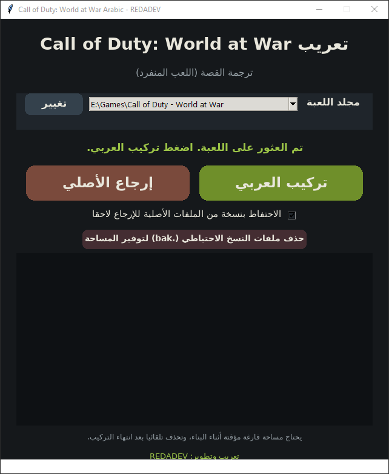

<div align="center">

# تعريب Call of Duty: World at War 🎖️

**مثبّت وأدوات تعريب طور القصة في لعبة Call of Duty: World at War**

[](LICENSE)
[](https://github.com/Reda6Dev/CoD-WaW-Arabic-Tools/releases)
[](https://www.python.org/)
[](https://github.com/Reda6Dev/CoD-WaW-Arabic-Tools/releases)

</div>

---

## ما هذا المشروع؟

أداة تعريب كاملة لطور القصة (اللعب المنفرد) في لعبة **Call of Duty: World at War**، تشمل القوائم والحوارات والأهداف ومقدمات المهمات بخط عربي واضح ومتصل من اليمين إلى اليسار.  
لا يحتوي هذا المستودع ولا ملف المثبّت على أي ملفات من اللعبة الأصلية؛ بل يطبّق التعريب مباشرة على نسخة اللعبة المثبّتة على جهازك.

---

## صورة من المثبّت

<p align="center">
  
</p>

---

## للاعبين: طريقة التثبيت في 3 خطوات

1. نزّل ملف **`WaW_Arabic.exe`** من صفحة [**التحميلات (Releases)**](https://github.com/Reda6Dev/CoD-WaW-Arabic-Tools/releases).
2. افتح البرنامج — سيجد مجلد اللعبة تلقائياً (وإن لم يجده اضغط **تغيير** واختر مجلد اللعبة الذي فيه `zone` و`main`).
3. اضغط **تركيب العربي** وانتظر حتى ينتهي، ثم شغّل اللعبة.

> **ملاحظة:** للرجوع إلى اللغة الإنجليزية في أي وقت، افتح البرنامج نفسه واضغط **إرجاع الأصلي** (تأكد من بقاء خيار حفظ النسخة الأصلية مفعّلاً قبل التركيب). كما يمكنك حذف النسخ الاحتياطية لاحقاً من الزر المخصص لتوفير المساحة.

---

## للمطورين والمترجمين: كيف تعدّل الترجمة أو تبني البرنامج؟

| المجلد / الملف | الوظيفة |
|---|---|
| `work/arabic/` | ملفات النصوص العربية القابلة للتعديل |
| `tools/` | ملفات الكود البرمجي والخطوط والإعدادات |
| ملفات `.bat` | أوامر جاهزة للاستخراج والفحص والبناء والتركيب |

### خطوات العمل:
1. ثبّت **Python 3** على ويندوز (وفعّل `Add Python to PATH`).
2. لتعديل أي جملة: افتح الملف المناسب داخل `work/arabic/` وعدّل النص بعد علامة `=`.
3. شغّل `0_تجميع_ملفات_اللعب_المنفرد.bat` إذا أردت نسخ ملفات اللعبة للعمل عليها.
4. شغّل `2_فحص_الترجمة.bat` ثم `3_بناء_الملفات.bat` ثم `4_تركيب_في_اللعبة.bat`.
5. لبناء ملف `.exe` واحد للاعبين، ثبّت المكتبات المطلوبة ثم شغّل `بناء_ملف_exe.bat`:
   ```bash
   python -m pip install pillow numpy pyinstaller
   ```

---

## ملاحظات سريعة

- التعريب مخصص لطور القصة فقط؛ قوائم اللعب الجماعي تبقى بالإنجليزية.
- قد يظهر تحذير ويندوز المعتاد («Windows protected your PC») لأن الملف غير موقّع رقمياً؛ اضغط **More info** ثم **Run anyway** (البرنامج لا يتصل بالإنترنت وكوده مفتوح هنا بالكامل).
- يتطلب استخدام الأداة امتلاك نسخة أصلية من اللعبة.

---

## الحقوق

- **تطوير وتعريب:** **Reda6Dev**
- **الخط المستخدم:** [DejaVu Sans](tools/fonts/LICENSE_DejaVu.txt)
- **الترخيص:** [MIT](LICENSE)
